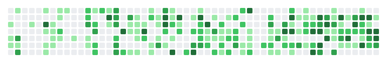

<div align="center">

# contribution-fx

**让你的 GitHub 贡献图活起来。**

把 GitHub 贡献图变成可以放进个人主页 README 的动画 SVG。<br>
5 种特效 · 5 套配色 · 亮色/暗色 · 一个 GitHub Action · 零依赖。

<a href="https://sur1ive.github.io/contribution-fx/"><b>▶ 输入用户名在线预览</b></a> ·
<a href="#快速开始">快速开始</a> ·
<a href="#主题">主题</a> ·
<a href="#参数">参数</a> ·
<a href="README.md">English</a>

<br><br>

<picture>
  <source media="(prefers-color-scheme: dark)" srcset="examples/gravity-dark.svg">
  
</picture>

</div>

## 主题

下面的示例都是本 Action 的真实输出（使用演示数据渲染）。所有主题无限循环播放，遵循系统的“减少动态效果”设置，动画关闭时会显示正常的静态贡献图。

| 主题 | 效果 |
| --- | --- |
| `gravity` | 每个有贡献的格子掉落到当周底部、弹跳、停留，再飘回原位 |
| `life` | 以你的贡献图为初始状态运行康威生命游戏，一代代演化 |
| `sort` | 每一天移动到排序后的位置，整年变成完美渐变，再飞回原处 |
| `ripple` | 最忙碌的几天像雨滴落入水面，冲击波扫过整张图（示例使用 `palette=ocean`） |
| `fireworks` | 你最高产的日子会升起烟花（示例使用 `palette=sunset`） |

<picture>
  <source media="(prefers-color-scheme: dark)" srcset="examples/life-dark.svg">
  
</picture>

<picture>
  <source media="(prefers-color-scheme: dark)" srcset="examples/sort-dark.svg">
  
</picture>

<picture>
  <source media="(prefers-color-scheme: dark)" srcset="examples/ripple-dark.svg">
  
</picture>

<picture>
  <source media="(prefers-color-scheme: dark)" srcset="examples/fireworks-dark.svg">
  
</picture>

## 快速开始

大约两分钟。你需要一个[个人主页仓库](https://docs.github.com/zh/account-and-profile/setting-up-and-managing-your-github-profile/customizing-your-profile/managing-your-profile-readme)（与用户名同名的公开仓库）。

**1. 添加工作流**：在主页仓库中创建 `.github/workflows/contribution-fx.yml`：

```yaml
name: contribution-fx

on:
  schedule:
    - cron: "0 0 * * *" # 每天刷新
  workflow_dispatch:

permissions:
  contents: write

jobs:
  generate:
    runs-on: ubuntu-latest
    steps:
      - uses: Sur1ive/contribution-fx@v1
        with:
          github_user_name: ${{ github.repository_owner }}
          outputs: |
            dist/contribution-fx.svg?theme=gravity
            dist/contribution-fx-dark.svg?theme=gravity&mode=dark

      - uses: crazy-max/ghaction-github-pages@v5
        with:
          target_branch: output
          build_dir: dist
        env:
          GITHUB_TOKEN: ${{ secrets.GITHUB_TOKEN }}
```

**2. 手动运行一次**：在 *Actions* 页签中选择 *contribution-fx → Run workflow*，它会创建一个存放 SVG 的 `output` 分支。

**3. 把下面的代码粘贴到 `README.md`**（替换 `USERNAME`）：

```html
<picture>
  <source media="(prefers-color-scheme: dark)" srcset="https://raw.githubusercontent.com/USERNAME/USERNAME/output/contribution-fx-dark.svg" />
  
</picture>
```

完成！之后工作流每天会自动更新。

> [!TIP]
> 不知道选哪个主题？[在线预览](https://sur1ive.github.io/contribution-fx/)可以用**你自己的**贡献图试遍所有主题和配色，并自动生成上面两段代码。

## 参数

`outputs` 每行一个文件路径，后面用查询字符串形式写参数，一次可以生成任意多个文件：

```yaml
outputs: |
  dist/life.svg?theme=life&palette=ocean
  dist/life-dark.svg?theme=life&palette=ocean&mode=dark
  dist/party.svg?theme=fireworks&palette=sunset&mode=dark&speed=1.5&label=true
```

| 参数         | 取值                                           | 默认值      |
| ------------ | ---------------------------------------------- | ----------- |
| `theme`      | `gravity` `life` `sort` `ripple` `fireworks`   | `gravity`   |
| `palette`    | `github` `ocean` `sunset` `purple` `halloween` | `github`    |
| `mode`       | `light` `dark`                                 | `light`     |
| `speed`      | 任意正数（`2` 表示两倍速）                     | `1`         |
| `background` | 任意 CSS 颜色，例如 `#0d1117`                  | 透明        |
| `label`      | `true` 时添加 “@你 · 过去一年 N 次贡献” 字样    | `false`     |

## 命令行与库

无需安装，Node 20+ 即可：

```bash
git clone https://github.com/Sur1ive/contribution-fx && cd contribution-fx
node bin/cli.js --user torvalds --theme life --mode dark -o life.svg
node bin/cli.js --demo --theme fireworks -o fireworks.svg   # 离线演示数据
```

渲染器是不依赖 Node API 的纯 ESM，可以直接在浏览器里运行（在线预览就是这么做的）。

## 贡献新主题

一个主题就是 [`src/themes/`](src/themes) 下的一个文件，导出 `render(ctx) → { style, body }`。[`gravity.js`](src/themes/gravity.js) 只有约 70 行，可以作为模板。运行 `npm test` 和 `npm run examples` 后打开 `examples/preview.html` 预览，欢迎提交 PR！

## 致谢

灵感来自 [Platane/snk](https://github.com/Platane/snk)。在线预览的数据来自 [grubersjoe/github-contributions-api](https://github.com/grubersjoe/github-contributions-api)。

如果 contribution-fx 让你的主页更有趣了，欢迎点个 ⭐，让更多人看到它！

## 许可证

[MIT](LICENSE)
